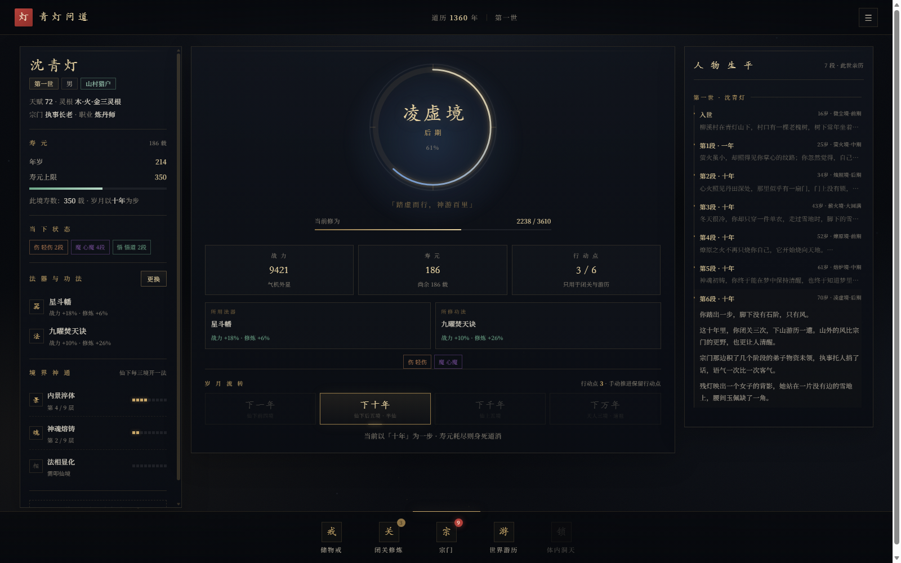
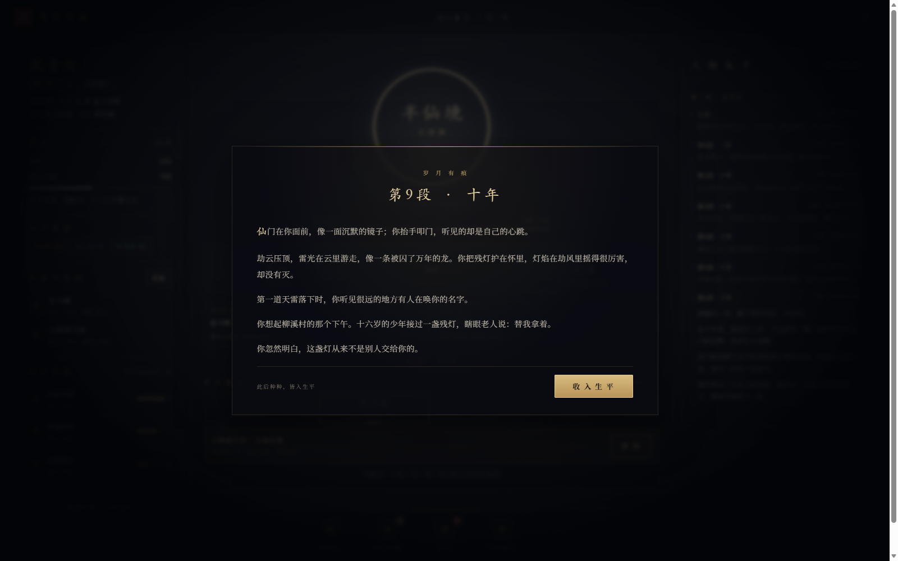
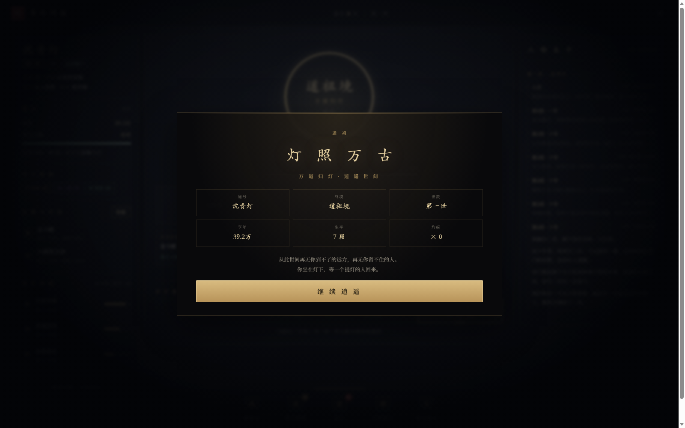

# 青灯问道

> 一盏残灯，照尽九霄。  
> 从人界微末，到仙界大能，再到万道归灯的道祖。

一个**纯前端、零依赖**的修仙文字游戏。十九重境界、七十二小境、四世轮回、宗门职司、世界游历、体内洞天、渡劫与鬼修。

## 开始游玩

直接用浏览器打开：

```text
index.html
```

无需服务器、无需安装依赖。推荐 Chrome / Edge / Firefox 桌面版；手机端也可横竖屏游玩。

> 存档自动写入浏览器 `localStorage`。换浏览器或清理站点数据会丢档。

## 预览

| 入世 | 主界面 |
| --- | --- |
|  |  |

| 岁月叙事 | 道祖结局 |
| --- | --- |
|  |  |

## 开局

1. 输入道号，选择性别与出身。
2. 灵根与天赋随机浮动；可“重掷灵根”。
3. 点击“燃灯入世”。
4. 在主页下方五大板块中闭关、游历、领取宗门物资。
5. 修至大圆满后点击“渡劫”，突破大境界。
6. 点击“下一年 / 下十年 / 下千年 / 下万年”推进岁月。

## 五个板块

| 板块 | 作用 |
| --- | --- |
| 储物戒 | 丹药、法器、功法、材料、阵盘；服用与装备 |
| 闭关修炼 | 洞府闭关、灵石辅修、丹药辅修、聚灵阵辅修；洞府升级；渡劫 |
| 宗门 | 领取累积物资、选择职业、炼丹/炼器/布阵、四阁兑换 |
| 世界游历 | 消耗 1 行动点，经历 3–4 桩事件，获取资源与机缘 |
| 体内洞天 | 仙上第一境·洞明境解锁；洞天、灵田、灵泉、道碑 |

## 核心规则

- **行动点**：初始 3，上限 6；每次推进 +3。只用于闭关与游历。
- **行动点耗尽**：默认自动推进下一段岁月；可在菜单中关闭，改为手动。
- **渡劫**：每个大境界大圆满后可渡劫；失败可能身死，渡厄丹 +25%。
- **寿元**：寿元耗尽即死；负面状态也会致死。大境界突破会增寿并清空负面状态。
- **天赋**：每次死亡永久提升。第一世天赋只够到半仙境，第二世必能到仙上五境。
- **转世**：第七境及以上死亡，10% 触发；重回烛照境时恢复前世所有修为，两世生平同书。
- **鬼修**：第五境及以上死亡，20% 触发；跌落一重大境界，失去职业，寿元为生前 2.5 倍。

## 境界

仙下九境：微尘、萤火、烛照、薪火、燎原、熔炉、凌虚、载道、叩仙。  
半仙：半仙。  
仙上五境：洞明、流照、无垢、执天、逍遥。  
天人三境：同天、造界、无始。  
道祖：道祖。

除道祖外，每境分前期、中期、后期、大圆满。

## 文件结构

```text
index.html          页面骨架
css/style.css       视觉与响应式
js/util.js          工具
js/data.js          境界、物品、宗门、配方、洞天
js/narrative.js     年度叙事、主线、结局文本
js/events.js        游历事件
js/engine.js        规则引擎
js/ui.js            界面与交互
js/main.js          启动与背景
tools/              开发用测试与模拟
设计文档.md          完整设计案
```

## 开发与测试

```bash
node tools/sim.js        # 规则测试
node tools/test-save.js  # 存档、结局、寿元测试
node tools/sim2.js       # 多世平衡模拟
```

## 说明

- 境界名称、宗门、人物、事件均为原创设计。
- 本项目为单机文字游戏，无联网、无付费、无外部依赖。
- 若浏览器禁用了 `file://` 的本地存储，游戏仍可运行，但刷新会丢失进度；可改用本地静态服务器打开。
